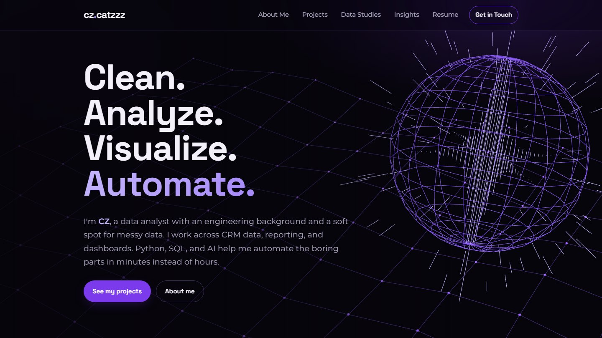
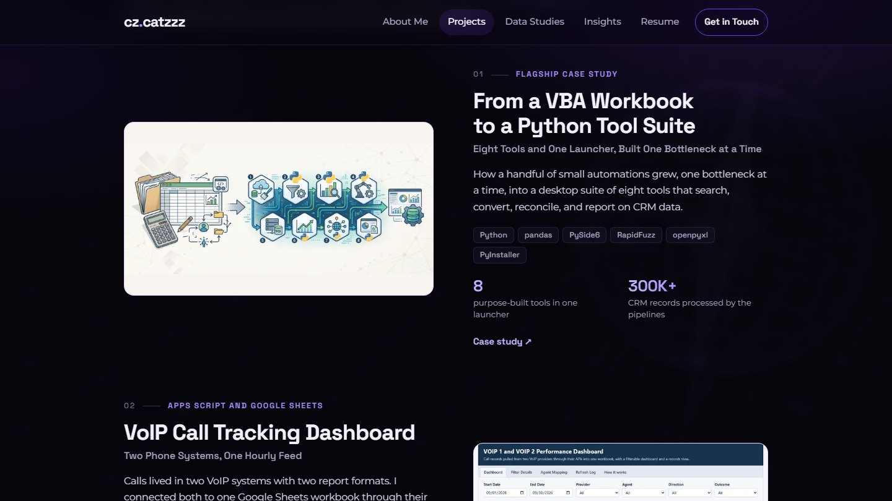
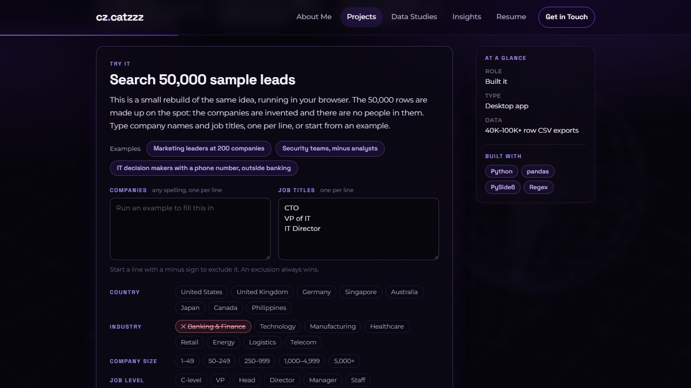

<div align="center">

# cz.catzzz

**The portfolio of CZ Catalan, data analyst.**
Clean. Analyze. Visualize. Automate.

[**Visit the site →**](https://chimcatz.github.io/cz-portfolio-site/)

[](https://github.com/ChimCatz/cz-portfolio-site/actions/workflows/deploy.yml)
[](https://github.com/ChimCatz/cz-portfolio-site/actions/workflows/checks.yml)


[](https://chimcatz.github.io/cz-portfolio-site/)

</div>

## What's on the site

| Page | What you'll find |
|---|---|
| [Projects](https://chimcatz.github.io/cz-portfolio-site/projects/) | Case studies of automation tools and dashboards: a Python desktop suite for CRM data work, live Zoho Analytics dashboards, a call tracking dashboard built on Google Apps Script, two open-source projects still in progress, and side projects made for fun. |
| [Data Studies](https://chimcatz.github.io/cz-portfolio-site/data-studies/) | Public datasets taken apart, with the charts, the method, and the data to download. |
| [Insights](https://chimcatz.github.io/cz-portfolio-site/insights/) | Writing on data, tools, and building with AI, including an interactive piece on the job market. |
| [About Me](https://chimcatz.github.io/cz-portfolio-site/about/) | Background, tool stack, and certifications. |
| [Resume](https://chimcatz.github.io/cz-portfolio-site/resume/) | Readable on the page, with a PDF download. |

## A closer look

| | |
|---|---|
| [](https://chimcatz.github.io/cz-portfolio-site/projects/) | [](https://chimcatz.github.io/cz-portfolio-site/projects/search-and-filter-engine/) |
| **Projects.** One filterable list, with status, version, and build-date badges on every project. | **A demo you can run.** Search 50,000 made-up rows in your browser, in about a millisecond. |

A few things worth opening:

- **[Search & Filter Engine](https://chimcatz.github.io/cz-portfolio-site/projects/search-and-filter-engine/):**
  the case study comes with a working demo. It generates 50,000 sample rows
  in the browser, reads company names and job titles the way the case study
  describes, and exports the matches as CSV.
- **[Live dashboards](https://chimcatz.github.io/cz-portfolio-site/projects/):**
  the dashboard projects open with the dashboard itself, embedded and
  interactive, on sample data.
- **[Too Many Applicants, Too Few Jobs](https://chimcatz.github.io/cz-portfolio-site/insights/too-many-applicants-too-few-jobs-and-how-to-win/):**
  a data story with charts drawn in the browser and a job-title search over
  831 occupations, built from open government data.

## How it's built

- **[Astro 5](https://astro.build/)**, fully static. No framework runtime,
  no backend, no database, no cookies, no analytics.
- **Three dependencies:** Astro and two font packages. Charts, the search
  demo, the lightbox, and the scroll animations are written by hand.
- **Content as folders.** Every project, data study, and insight is a folder
  with a Markdown file and its images. Adding one needs no other change:
  lists, the homepage, "next" links, and the sitemap pick it up.
- **Typed content.** Frontmatter is checked against a schema at build time,
  so a missing field fails the build instead of breaking a page.
- **Images** are resized and converted at build time; visitors never
  download an original.
- **Accessible by default:** keyboard support, reduced-motion support, and
  every layout checked at desktop, laptop, and phone sizes.
- **Smooth on modest hardware:** only transform and opacity animate, loops
  stop when they're off screen, heavy embeds load on a click, and the
  background globe renders at a lower resolution and frame rate wherever it
  sits blurred behind the page, without changing how it looks.
- **Checked by a script:** `npm run check` opens every page at three screen
  sizes and fails on script errors, sideways scrolling, or an oversized
  footer. It can also compare layouts before and after a change, and
  measure frame rates.
- **Published by GitHub Actions** to GitHub Pages on every push to `main`.

## Project structure

```
.
├── rebrand/                 The site (Astro)
│   ├── src/
│   │   ├── pages/           One file per page; [slug].astro for entries
│   │   ├── content/         Projects, data studies, insights (a folder each)
│   │   ├── layouts/         Page shell, reading layout, list layout
│   │   ├── components/      Header, footer, globe, lightbox, charts, demo
│   │   ├── lib/             Helpers, Markdown plugins, the search engine
│   │   ├── styles/          global.css: brand colors, fonts, base styles
│   │   ├── assets/          Images optimized at build time
│   │   └── data/            Data files used by charts
│   ├── public/              Files served as they are (resume, dashboards)
│   └── scripts/             Helper scripts (logos, screenshots, resume image)
├── source-files/            Originals the site is made from (not published)
├── setup/                   Scripts for rebuilding the dev setup on a new PC
├── temp/                    Drop folder for new files (ignored by git)
└── .github/                 Deploy and check workflows, repo check script
```

## Run it locally

You need [Node.js](https://nodejs.org/) 20 or newer.

```bash
git clone https://github.com/ChimCatz/cz-portfolio-site.git
cd cz-portfolio-site/rebrand
npm install
npm run dev
```

| Command (inside `rebrand/`) | What it does |
|---|---|
| `npm run dev` | Starts the site locally and reloads on every save. |
| `npm run build` | Builds the final site into `rebrand/dist/`. |
| `npm run preview` | Serves the built site, as it will be published. |
| `npm run resume` | Re-renders the Resume page image from the PDF (needs Python with PyMuPDF). |
| `npm run logos` | Rebuilds the tool logos on About Me from `source-files/logos/`. |
| `npm run project-art` | Re-renders dashboard screenshots and the link-preview card (needs Playwright). |
| `npm run check` | Checks every built page at three screen sizes; `-- --compare` and `-- --perf` for layout and frame-rate comparisons (needs Playwright). |

## Adding content

Add a folder under `rebrand/src/content/`:

```
rebrand/src/content/insights/my-new-insight/
├── index.md        Frontmatter (title, slug, date, summary, banner) + the text
└── banner.png
```

That's all. The fields each kind of entry takes are listed in
[`rebrand/src/content.config.ts`](rebrand/src/content.config.ts).

## Publishing

Every push to `main` runs the repo check, builds the site, and publishes it
to GitHub Pages ([`deploy.yml`](.github/workflows/deploy.yml)). Work happens
on a branch and reaches the site when it is merged into `main`. Every other
push and pull request gets the same check and a test build
([`checks.yml`](.github/workflows/checks.yml)).

## Sample data and privacy

- Projects are shown under generic tool names, and case studies describe
  approaches and results.
- The dashboards, the sample workbook, and the search demo use sample or
  made-up data. Names in them are sample names.
- The site collects nothing: no cookies, no analytics, no forms.

The full wording is on the site's
[Terms & Policies](https://chimcatz.github.io/cz-portfolio-site/terms/) page.

## Security

This is a static site with nothing behind it to sign in to. The safeguards
are about what gets committed: a check for secrets and stray files runs
before every commit, on every push, and again before every publish. See
[`SECURITY.md`](SECURITY.md), which also says how to report a problem.

After cloning, turn the commit check on:

```bash
git config core.hooksPath .githooks
```

## What a clone does not include

Git ignores a few things on purpose, so they exist only on the computer they
were created on:

| Not in a clone | How to get it |
|---|---|
| `rebrand/node_modules/`, `rebrand/dist/`, `rebrand/.astro/` | Recreated by `npm install` and `npm run build`. |
| `temp/` contents | Nothing to get: it only holds files waiting to be used. |
| `private/` | Personal notes and source material. Copy it by hand if you need it on another computer. |
| `.env` files, keys | There are none. The site needs no secrets to build or run. |

None of these are needed to build the site: a fresh clone builds and
publishes exactly what is live.

## License

© 2026 Chim Zoe Catalan. All rights reserved. You're welcome to read the
code and learn from it; please don't reuse the content, design, or images.
Open-source software, logos, and datasets in the repo belong to their owners
under their own terms. See [`LICENSE`](LICENSE).
