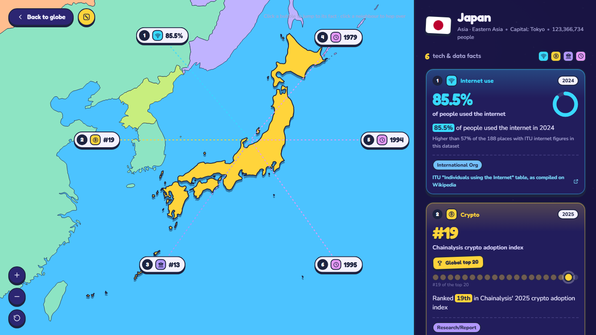

## Why I made it

I wanted to know how far planning and prompting alone could take a project. I didn't want a to-do app. I wanted something with real data in it, data I would have to trust and check.

So the brief was simple to say and hard to do: a globe you can spin, where clicking any country shows facts about its tech and data, and every fact has a source.

## Step 1: Research the facts

The facts came first. I used Claude's deep research to collect tech and data facts for every country and territory: internet use, e-government rankings, mobile data prices, broadband speeds, crypto adoption, cybersecurity, space, and tech history.

The output was a dataset, not a list of fun facts. Every row has a country, a fact, a source type, and a short source key. A separate table maps each key to the link it stands for. The source type matters: an international body, a news report and a company's own marketing are not equally reliable, and the globe shows which one each fact comes from.

A second research round filled the gaps. It covered small territories that had only one or two facts, added Antarctica, and gave the big tech nations more history: first cables, first satellites, first domains.

## Step 2: Let Claude Code build it

With the data ready, Claude Code wrote the globe in plain HTML, CSS and JavaScript, with no framework and no build step. Small Python scripts turn the research files into the data the page reads.

Click a country and the globe flies into a map of it. Each fact becomes a card with its headline number, a small chart for that kind of figure, the year, the source type and a link to the source.

## What I did, and what the AI did

My part was the plan and the prompts: what the globe should do, what each fact needed to include, what to research next, and what to change after each try. Claude did the research, and Claude Code wrote every line of code.

## What it taught me about data

The globe is the fun part. What I learned was mostly about data:

- **A fact is only as good as its source.** A script checks every fact's source key, its highlighted phrase and its link. Some publishers block automated checks, so those links still have to be opened by hand.
- **Names never match across datasets.** The research and the country list spell some places differently, so a short list of aliases connects them.
- **Fail loudly, don't guess.** When a new fact doesn't fit any rule, the build stops with an error instead of making up a card for it.
- **Dates belong next to the numbers.** Most figures are from 2020 to 2026 and will go out of date, so each card shows its year.

## Data and credits

Each fact links to its original source. Country shapes come from Natural Earth (public domain), country profiles from the mledoze/countries project (ODbL), and population figures from World Bank Open Data (CC BY 4.0). Flags come from flagcdn.com. The full list and the code are in the repo.
