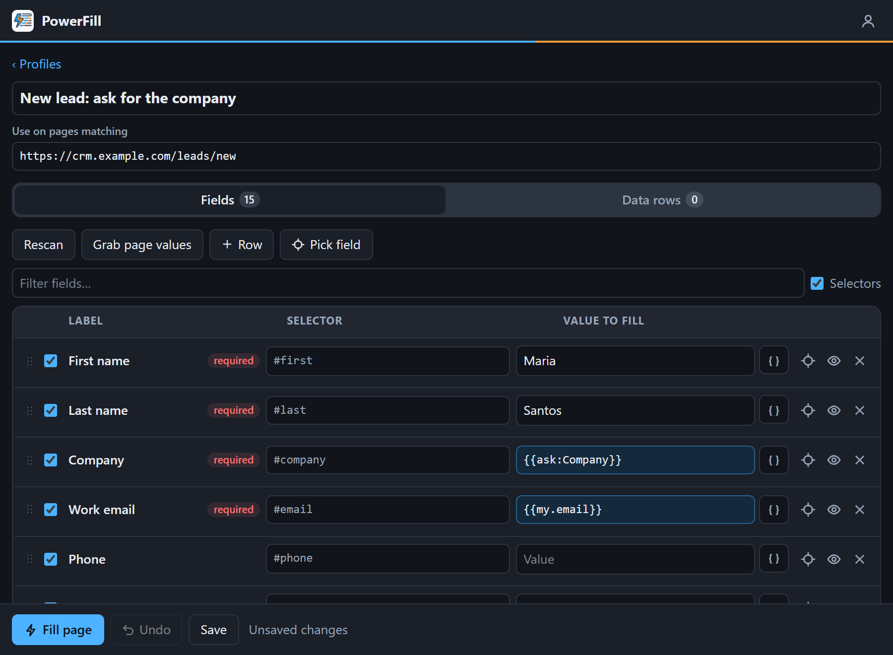
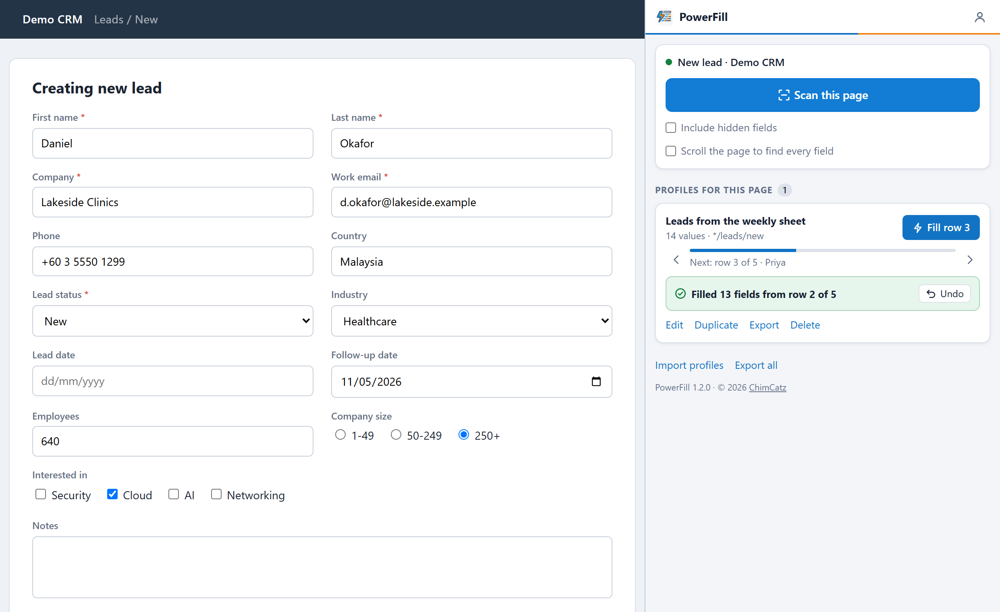
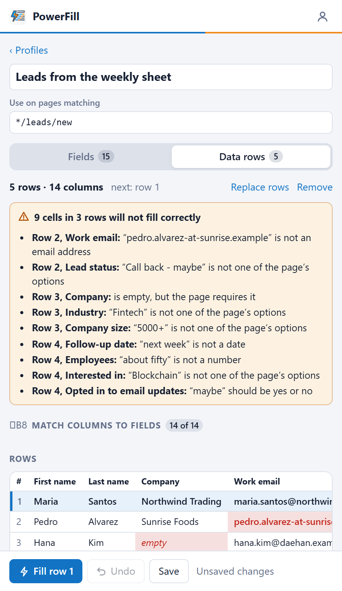
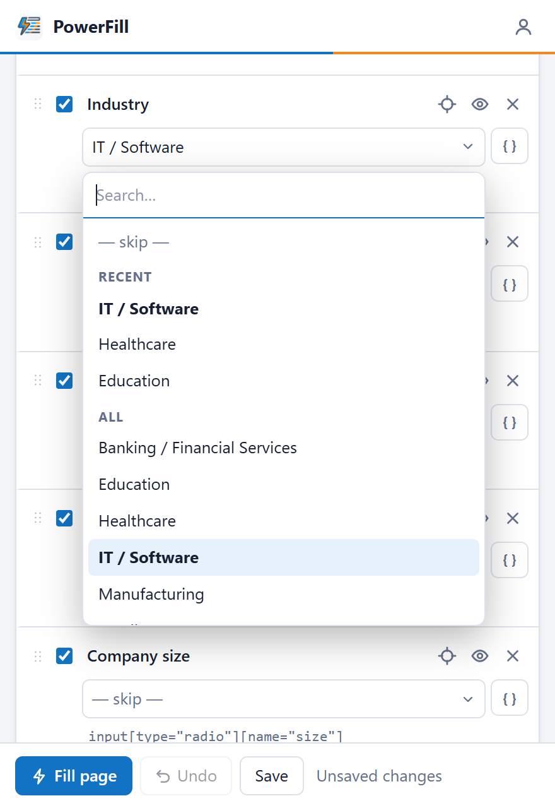

## The problem

Some web forms get filled in the same way all day: the same picklists, the same defaults, and one new name each time. A browser's autofill doesn't help, because it knows addresses and card numbers, not the fifteen fields of a lead form. Macro recorders replay clicks, and they break as soon as the page shifts.

PowerFill treats the form like a spreadsheet instead. Every field becomes a row, you type each value once, and the sheet is saved to be used again.

## A form becomes a sheet

Open the form, click the PowerFill icon, and press **Scan this page**. A panel opens beside the page and lists every field it found as one row: **Label**, **Selector**, **Value**. Text boxes, picklists, multi-selects, checkboxes, radio groups, and rich-text boxes are all read the same way.

Type the values you want, press **Fill page** to try them, then save the sheet as a **profile**. A profile remembers which pages it belongs to through an address pattern, so the next time that form is open, filling it is one click or **Alt+Shift+F**.

A few details make a profile quicker to build and to repair:

- **Grab page values** copies whatever is typed into the page into the sheet, so one way to build a profile is to fill the form by hand once.
- Fields are filled in the order of the sheet, and rows can be dragged or moved with the arrow keys.
- When a selector misses, you can click the field on the page to pick it, or paste a selector, JS path, or XPath copied from DevTools.

## Filling a list, one record at a time

Entering a list of records is the same form over and over with different values, so a profile can carry **data rows**. Copy the cells from Excel or Google Sheets with their heading row, paste them in, and columns whose heading matches a field's label are matched automatically. After that, each press of Fill takes the next row: fill, check, save the record on the page, fill again.

Before anything is filled, the tab checks every matched cell against what the page will accept and lists the ones that won't go in: a picklist value that isn't an option, an email without an @, text where a number or date belongs, or a blank where the page requires a value.

 

## Values worked out at fill time

Not every value is fixed. A row can hold a token that is replaced when the form is filled:

| Value | What it does |
| --- | --- |
| `{{ask:Company}}` | Asks for "Company" every time you fill |
| `{{my.email}}` | Your own saved detail called `email` |
| `{{Company}}` | The `Company` column of the current data row |
| `{{today+7}}` | A date seven days from today, in the format the field expects |
| `{{clear}}` | Empties the field |

**My details** holds the values that are yours alone, such as your name and email. They are never exported, so a shared profile that uses `{{my.email}}` fills in each person's own address.

## It reports what it did

Filling is only safe to trust if you can see what happened, so every fill ends with a report:

- Each row gets a **green** edge when it filled, **orange** when it filled but the page says the value is wrong, and **red** when it could not be filled, with the reason.
- **Required by the page but still empty** lists what will stop the page from saving.
- **Undo** puts every field the fill changed back the way it was.

PowerFill never submits a form. Saving the record stays a decision made by the person looking at the page.

## Built for awkward pages

Real forms are rarely plain HTML. The engine that runs in the page handles Select2 dropdowns, React-style forms that ignore a plain value change, iframes, and shadow DOM.

Some pages only load part of a form once you scroll to it. An optional **scrolling scan** scrolls the page from top to bottom before reading it, under strict rules: it only scrolls, it stops the moment you click, type, scroll, or press Esc, it gives up after 20 seconds, and it puts the page back where it was.

## Tested the way it's used

The repository includes an end-to-end test suite that loads the extension into headless Chrome and drives it the way a person would: scan, type values, fill, undo. It runs against a made-up lead form and against fixture pages for unusual widgets, an iframe, and a long page that reveals fields as it scrolls. Every screen of the panel is also checked for overflow from 300px to 1400px wide.

The extension itself is plain JavaScript with no dependencies and no build step: edit a file, reload the extension, and the change is live.

## What stays on your computer

- Profiles, data rows, and personal details are stored in your own browser.
- An exported profile leaves out the data rows and your personal details, so sharing a profile never shares a list.
- Hidden fields are skipped by default, because on public sites they are often spam traps.
- Values are stored as plain text, so the documentation says plainly not to save real passwords in a profile.

## Where it stands

Version 1.2.0 came out of the first round of testing by other people. It added field reordering, search inside picklists, recent values, and the scrolling scan, and it fixed a layout bug where a long page address pushed the Fill button out of a narrow panel.

PowerFill is not on the Chrome Web Store. It is loaded from a folder, which takes about a minute, and it can't fill file uploads or CAPTCHAs.

## What I learned

**The report matters as much as the fill.** A tool that fills 14 of 15 fields silently is worse than no tool. Saying which field failed, and why, is what makes it usable on a form that matters.

**Test through the real interface.** A long page address once pushed the Fill button out of a narrow panel, which no test of a single function would notice. The suite now opens every screen at widths from 300px to 1400px.
